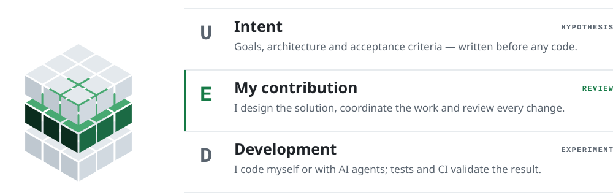
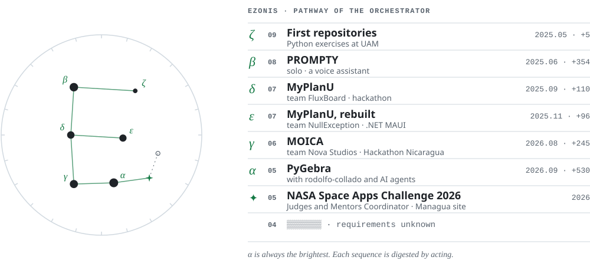
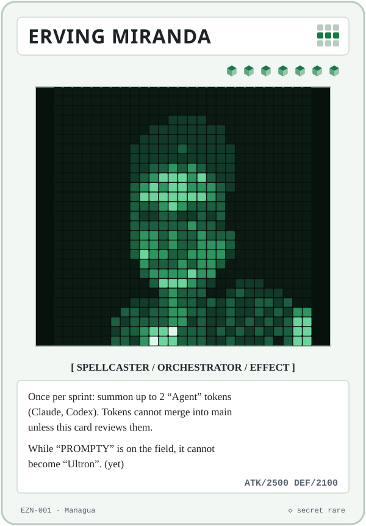
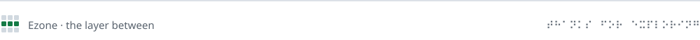

<!-- you are reading the source. that makes you an observer. ⠞⠓⠑ ⠇⠁⠽⠑⠗ ⠃⠑⠞⠺⠑⠑⠝ -->

<p align="right"><sub><a href="README.md">Español</a> · English</sub></p>

<picture>
  <source media="(prefers-color-scheme: dark)" srcset="assets/hero-en-dark.svg">
  
</picture>

I'm a Systems Engineering student at Universidad Americana (UAM) in Managua, Nicaragua. In my projects I combine programming with AI tools: I set goals, design solutions, take part in development, and review the results before merging them.

Python · Java · C# &nbsp;—&nbsp; currently working on [PyGebra](https://github.com/Collado-Labs/Algebra-Lineal).

## Selected work

<a href="https://github.com/ErvingMiranda/PROMPTY"><picture><source media="(prefers-color-scheme: dark)" srcset="assets/prompty-en-dark.svg"></picture></a>

A desktop voice assistant written in Python: it listens, talks back, searches the web, plays music and manages users with different permission levels, behind a PyQt6 interface. It is my first ambitious project — I rewrote it four times (1.0 → 3.0) while learning how to structure software in layers.<br>
<sub>Solo project · Python, PyQt6, SpeechRecognition, pyttsx3 · <a href="https://github.com/ErvingMiranda/PROMPTY">ErvingMiranda/PROMPTY</a></sub>

<a href="https://github.com/ErvingMiranda/MyPlanU"><picture><source media="(prefers-color-scheme: dark)" srcset="assets/myplanu-en-dark.svg"></picture></a>

A collaborative planner for students: goals, events, reminders and shared activities. It began at a hackathon with team FluxBoard as a FastAPI + Expo app, and we rebuilt it for a university course with team NullException in .NET MAUI, with a light version of PROMPTY embedded as its assistant.<br>
<sub>Two teams · FastAPI, SQLModel, Expo → C#, .NET MAUI, SQLite · <a href="https://github.com/ErvingMiranda/MyPlanU">ErvingMiranda/MyPlanU</a> · <a href="https://github.com/ErvingMiranda/MyPlanU-NullException">MAUI rebuild</a></sub>

<a href="https://github.com/robertofabiot/moica-hackathon"><picture><source media="(prefers-color-scheme: dark)" srcset="assets/moica-en-dark.svg"></picture></a>

A web app designed to be used from a phone that connects clients with independent workers and small trades in Managua, and builds trust between them: manual identity verification, tracked service requests, chat after acceptance and mutual ratings. We built it at Nova Studios for Hackathon Nicaragua 2026.<br>
<sub>Team project (Nova Studios) · Java 21, Spring Boot, React, PostgreSQL · repository by robertofabiot: <a href="https://github.com/robertofabiot/moica-hackathon">moica-hackathon</a></sub>

<a href="https://github.com/Collado-Labs/Algebra-Lineal"><picture><source media="(prefers-color-scheme: dark)" srcset="assets/pygebra-en-dark.svg"></picture></a>

An educational calculator for linear algebra that shows every step instead of just the answer: row reduction, LU, Cramer, inverses, root-finding and set operations, with exact fractions and algorithms written by hand in standard Python. It ships as an offline Windows installer, with 20 releases and 100 test files so far. This is the project where I work as an orchestrator of AI agents.<br>
<sub>With rodolfo-collado and AI agents · Python · repository owned by Collado-Labs: <a href="https://github.com/Collado-Labs/Algebra-Lineal">Algebra-Lineal</a></sub>

## How I work

<picture><source media="(prefers-color-scheme: dark)" srcset="assets/method-en-dark.svg"></picture>

Not every project needs the same approach. Sometimes I code directly; other times I work with AI agents to build and test solutions. What matters is having clear goals, understanding what is being built, and reviewing the results.

<details>
<summary>Lab notebook — PyGebra</summary>

```
hypothesis   students learn more if the calculator shows its work
method       algorithms by hand in standard python · exact fractions
experiment   agents implement, tests decide · 100 test files
observation  20 releases · latest v0.18.0 · works offline
conclusion   ship it. then ship it again.
```

</details>

## The path so far

<picture><source media="(prefers-color-scheme: dark)" srcset="assets/path-en-dark.svg"></picture>

## Off-grid

When I'm not coding: Rubik's cubes, chess, math and science, mythology, trading cards, and more fictional universes than I can count.

<details>
<summary>One more thing</summary>
<p align="center">
<picture><source media="(prefers-color-scheme: dark)" srcset="assets/card-en-dark.svg"></picture><br>
<sub>Level 7. If you know, you know.</sub>
</p>
</details>

<picture><source media="(prefers-color-scheme: dark)" srcset="assets/footer-en-dark.svg"></picture>
