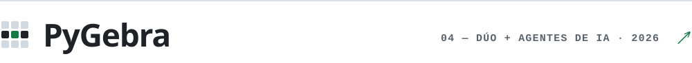
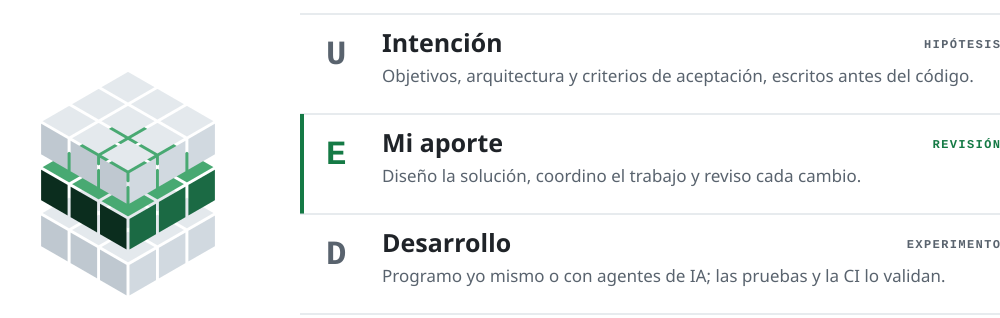
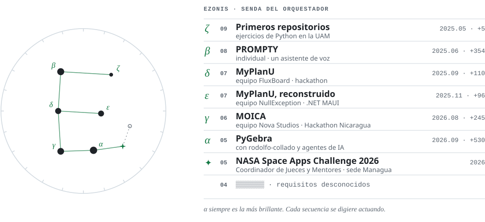
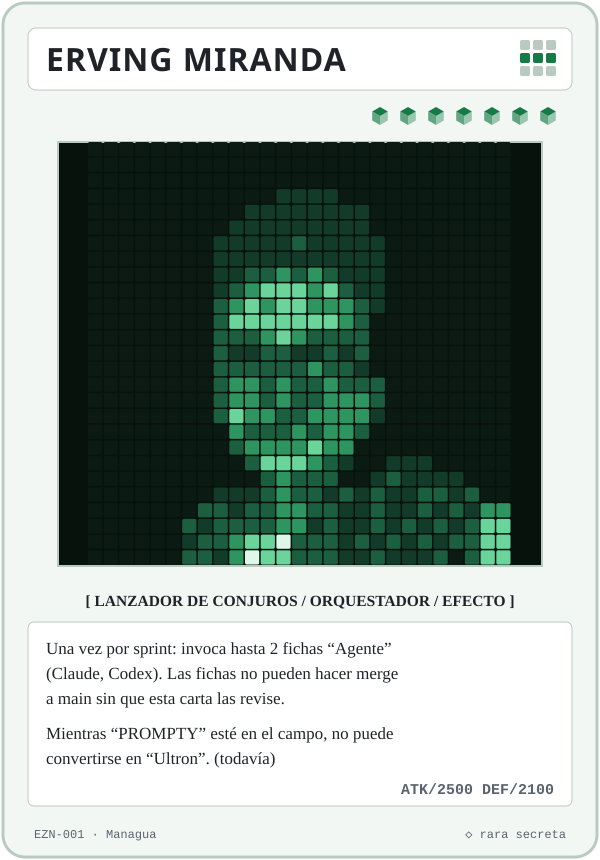
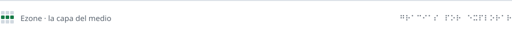

<!-- estás leyendo el código fuente. eso te convierte en observador. ⠇⠁ ⠉⠁⠏⠁ ⠙⠑⠇ ⠍⠑⠙⠊⠕ -->

<p align="right"><sub>Español · <a href="README.en.md">English</a></sub></p>

<picture>
  <source media="(prefers-color-scheme: dark)" srcset="assets/hero-es-dark.svg">
  
</picture>

Soy estudiante de Ingeniería en Sistemas en la Universidad Americana (UAM), en Managua, Nicaragua. En mis proyectos combino la programación con herramientas de IA: defino objetivos, diseño soluciones, participo en el desarrollo y reviso los resultados antes de integrarlos.

Python · Java · C# &nbsp;—&nbsp; actualmente trabajando en [PyGebra](https://github.com/Collado-Labs/Algebra-Lineal).

## Proyectos destacados

<a href="https://github.com/ErvingMiranda/PROMPTY"><picture><source media="(prefers-color-scheme: dark)" srcset="assets/prompty-es-dark.svg"></picture></a>

Un asistente de voz de escritorio hecho en Python: escucha, responde, busca en la web, reproduce música y maneja usuarios con distintos niveles de permiso, todo desde una interfaz en PyQt6. Es mi primer proyecto ambicioso: lo reescribí cuatro veces (de la 1.0 a la 3.0) mientras aprendía a organizar el software por capas.<br>
<sub>Proyecto individual · Python, PyQt6, SpeechRecognition, pyttsx3 · <a href="https://github.com/ErvingMiranda/PROMPTY">ErvingMiranda/PROMPTY</a></sub>

<a href="https://github.com/ErvingMiranda/MyPlanU"><picture><source media="(prefers-color-scheme: dark)" srcset="assets/myplanu-es-dark.svg"></picture></a>

Una agenda colaborativa para estudiantes: metas, eventos, recordatorios y actividades compartidas. Nació en un hackathon con el equipo FluxBoard, como una app en FastAPI + Expo, y la reconstruimos para una clase de la universidad con el equipo NullException en .NET MAUI, con una versión ligera de PROMPTY integrada como asistente.<br>
<sub>Dos equipos · FastAPI, SQLModel, Expo → C#, .NET MAUI, SQLite · <a href="https://github.com/ErvingMiranda/MyPlanU">ErvingMiranda/MyPlanU</a> · <a href="https://github.com/ErvingMiranda/MyPlanU-NullException">versión en MAUI</a></sub>

<a href="https://github.com/robertofabiot/moica-hackathon"><picture><source media="(prefers-color-scheme: dark)" srcset="assets/moica-es-dark.svg"></picture></a>

Una aplicación web pensada para usarse desde el celular que conecta a clientes con trabajadores independientes y pequeños oficios de Managua, y genera confianza entre ambos: verificación manual de identidad, seguimiento de solicitudes, chat después de aceptar el servicio y calificaciones mutuas. La desarrollamos en Nova Studios para el Hackathon Nicaragua 2026.<br>
<sub>Proyecto en equipo (Nova Studios) · Java 21, Spring Boot, React, PostgreSQL · repositorio de robertofabiot: <a href="https://github.com/robertofabiot/moica-hackathon">moica-hackathon</a></sub>

<a href="https://github.com/Collado-Labs/Algebra-Lineal"><picture><source media="(prefers-color-scheme: dark)" srcset="assets/pygebra-es-dark.svg"></picture></a>

Una calculadora educativa de álgebra lineal que muestra cada paso en lugar de dar solo el resultado: reducción por filas, LU, Cramer, inversas, búsqueda de raíces y operaciones con conjuntos, con fracciones exactas y algoritmos escritos a mano en Python estándar. Se distribuye como un instalador para Windows que funciona sin internet, y lleva 20 versiones publicadas y 100 archivos de pruebas. Es el proyecto donde trabajo como orquestador de agentes de IA.<br>
<sub>Con rodolfo-collado y agentes de IA · Python · repositorio de Collado-Labs: <a href="https://github.com/Collado-Labs/Algebra-Lineal">Algebra-Lineal</a></sub>

## Cómo trabajo

<picture><source media="(prefers-color-scheme: dark)" srcset="assets/method-es-dark.svg"></picture>

No todos los proyectos necesitan el mismo enfoque. A veces programo directamente; otras veces colaboro con agentes de IA para desarrollar y probar soluciones. Lo importante es tener objetivos claros, comprender lo que se construye y revisar los resultados.

<details>
<summary>Cuaderno de laboratorio — PyGebra</summary>

```
hipótesis     se aprende más si la calculadora muestra el procedimiento
método        algoritmos a mano en python estándar · fracciones exactas
experimento   los agentes implementan, las pruebas deciden · 100 archivos de pruebas
observación   20 versiones publicadas · la última, v0.18.0 · funciona sin internet
conclusión    se publica. y después se vuelve a publicar.
```

</details>

## El camino hasta aquí

<picture><source media="(prefers-color-scheme: dark)" srcset="assets/path-es-dark.svg"></picture>

## Fuera de línea

Cuando no estoy programando: cubos de Rubik, ajedrez, matemáticas y ciencia, mitología, cartas coleccionables y más universos de ficción de los que puedo contar.

<details>
<summary>Una cosa más</summary>
<p align="center">
<picture><source media="(prefers-color-scheme: dark)" srcset="assets/card-es-dark.svg"></picture><br>
<sub>Nivel 7. El que sabe, sabe.</sub>
</p>
</details>

<picture><source media="(prefers-color-scheme: dark)" srcset="assets/footer-es-dark.svg"></picture>
